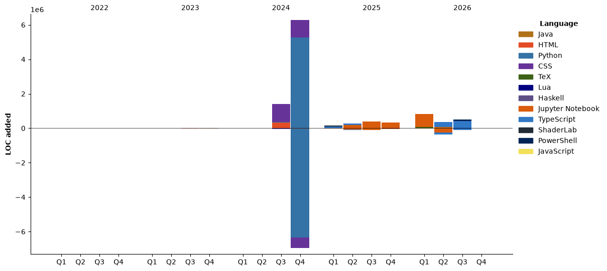

<h1 align="center">
  
</h1>

<p align="center">
  <a href="https://github.com/JSR-Mario"></a>
  <a href="https://www.linkedin.com/in/juan-sosa-997405294"></a>
  
</p>

---

```python
#!/usr/bin/python
# -*- coding: utf-8 -*-


class TechUser:

    def __init__(self):
        self.name = "Juan Mario Sosa"
        self.role = ["SRE","Software Engineer","Data scientist"]
        self.language_spoken = ["es_ES", "en_US"]

    def hi(self):
        print("This works ...")
        # TODO : ...

mario = TechUser()
mario.hi()
```

##  My Coding Activity

<!-- wakatime-stats injected here -->
<!--START_SECTION:waka-->


**🐱 My GitHub Data** 

> 📦 865.7 kB Used in GitHub's Storage 
 > 
> 🏆 1,610 Contributions in the Year 2026
 > 
> 💼 Opted to Hire
 > 
> 📜 30 Public Repositories 
 > 
> 🔑 9 Private Repositories 
 > 
**I'm a Night 🦉** 

```text
🌞 Morning                672 commits         ⣿⣿⣿⣀⣀⣀⣀⣀⣀⣀⣀⣀⣀⣀⣀⣀⣀⣀⣀⣀⣀⣀⣀⣀⣀   12.29 % 
🌆 Daytime                1280 commits        ⣿⣿⣿⣿⣿⣿⣀⣀⣀⣀⣀⣀⣀⣀⣀⣀⣀⣀⣀⣀⣀⣀⣀⣀⣀   23.42 % 
🌃 Evening                2761 commits        ⣿⣿⣿⣿⣿⣿⣿⣿⣿⣿⣿⣿⣿⣀⣀⣀⣀⣀⣀⣀⣀⣀⣀⣀⣀   50.51 % 
🌙 Night                  753 commits         ⣿⣿⣿⣀⣀⣀⣀⣀⣀⣀⣀⣀⣀⣀⣀⣀⣀⣀⣀⣀⣀⣀⣀⣀⣀   13.78 % 
```
📅 **I'm Most Productive on Wednesday** 

```text
Monday                   688 commits         ⣿⣿⣿⣀⣀⣀⣀⣀⣀⣀⣀⣀⣀⣀⣀⣀⣀⣀⣀⣀⣀⣀⣀⣀⣀   12.59 % 
Tuesday                  870 commits         ⣿⣿⣿⣿⣀⣀⣀⣀⣀⣀⣀⣀⣀⣀⣀⣀⣀⣀⣀⣀⣀⣀⣀⣀⣀   15.92 % 
Wednesday                979 commits         ⣿⣿⣿⣿⣀⣀⣀⣀⣀⣀⣀⣀⣀⣀⣀⣀⣀⣀⣀⣀⣀⣀⣀⣀⣀   17.91 % 
Thursday                 854 commits         ⣿⣿⣿⣿⣀⣀⣀⣀⣀⣀⣀⣀⣀⣀⣀⣀⣀⣀⣀⣀⣀⣀⣀⣀⣀   15.62 % 
Friday                   824 commits         ⣿⣿⣿⣿⣀⣀⣀⣀⣀⣀⣀⣀⣀⣀⣀⣀⣀⣀⣀⣀⣀⣀⣀⣀⣀   15.08 % 
Saturday                 571 commits         ⣿⣿⣿⣀⣀⣀⣀⣀⣀⣀⣀⣀⣀⣀⣀⣀⣀⣀⣀⣀⣀⣀⣀⣀⣀   10.45 % 
Sunday                   680 commits         ⣿⣿⣿⣀⣀⣀⣀⣀⣀⣀⣀⣀⣀⣀⣀⣀⣀⣀⣀⣀⣀⣀⣀⣀⣀   12.44 % 
```


📊 **This Week I Spent My Time On** 

```text
🕑︎ Time Zone: America/Mexico_City

💬 Programming Languages: 
Markdown                 7 hrs 27 mins       ⣿⣿⣿⣿⣿⣿⣿⣿⣿⣿⣿⣿⣿⣿⣿⣿⣿⣿⣿⣿⣿⣿⣿⣀⣀   92.23 % 
Text                     21 mins             ⣿⣀⣀⣀⣀⣀⣀⣀⣀⣀⣀⣀⣀⣀⣀⣀⣀⣀⣀⣀⣀⣀⣀⣀⣀   04.53 % 
Other                    15 mins             ⣿⣀⣀⣀⣀⣀⣀⣀⣀⣀⣀⣀⣀⣀⣀⣀⣀⣀⣀⣀⣀⣀⣀⣀⣀   03.23 % 

🔥 Editors: 
Obsidian                 7 hrs 13 mins       ⣿⣿⣿⣿⣿⣿⣿⣿⣿⣿⣿⣿⣿⣿⣿⣿⣿⣿⣿⣿⣿⣿⣀⣀⣀   89.41 % 
Chrome                   29 mins             ⣿⣿⣀⣀⣀⣀⣀⣀⣀⣀⣀⣀⣀⣀⣀⣀⣀⣀⣀⣀⣀⣀⣀⣀⣀   06.06 % 
VS Code                  21 mins             ⣿⣀⣀⣀⣀⣀⣀⣀⣀⣀⣀⣀⣀⣀⣀⣀⣀⣀⣀⣀⣀⣀⣀⣀⣀   04.53 % 
Antigravity CLI          0 secs              ⣀⣀⣀⣀⣀⣀⣀⣀⣀⣀⣀⣀⣀⣀⣀⣀⣀⣀⣀⣀⣀⣀⣀⣀⣀   00.00 % 

🐱‍💻 Projects: 
Obsidian Vault           7 hrs 42 mins       ⣿⣿⣿⣿⣿⣿⣿⣿⣿⣿⣿⣿⣿⣿⣿⣿⣿⣿⣿⣿⣿⣿⣿⣿⣀   95.46 % 
DWB                      21 mins             ⣿⣀⣀⣀⣀⣀⣀⣀⣀⣀⣀⣀⣀⣀⣀⣀⣀⣀⣀⣀⣀⣀⣀⣀⣀   04.53 % 
JSR-Mario                0 secs              ⣀⣀⣀⣀⣀⣀⣀⣀⣀⣀⣀⣀⣀⣀⣀⣀⣀⣀⣀⣀⣀⣀⣀⣀⣀   00.00 % 

💻 Operating System: 
Windows                  7 hrs 35 mins       ⣿⣿⣿⣿⣿⣿⣿⣿⣿⣿⣿⣿⣿⣿⣿⣿⣿⣿⣿⣿⣿⣿⣿⣀⣀   93.94 % 
Linux                    29 mins             ⣿⣿⣀⣀⣀⣀⣀⣀⣀⣀⣀⣀⣀⣀⣀⣀⣀⣀⣀⣀⣀⣀⣀⣀⣀   06.06 % 
```

🤖 **AI Coding This Week** 

```text
⏱ AI Coding Time: 0 secs (0.0%)

✍️ 0 lines written by AI, 434 lines written by hand (0.0% AI-written)

🔤 14,184 Input Tokens, 274 Output Tokens

💵 $0.06 Estimated AI Cost This Week

🧠 1 AI Sessions, 1 AI Prompts

Opus                     0 lines             ⣀⣀⣀⣀⣀⣀⣀⣀⣀⣀⣀⣀⣀⣀⣀⣀⣀⣀⣀⣀⣀⣀⣀⣀⣀   00.00 % 

🔎 AI Coding Insights:
🧑‍💻 Mostly Hands-On — 0.0% of written lines came from AI
📝 Concise Prompter — average 463 characters per prompt
🎯 One-Shot Prompter — average 1 prompts per session
🔍 Hands-On Reviewer — 100.0% of changed lines were hand-edited
```

**I Mostly Code in Java** 

```text
Jupyter Notebook         9 repos             ⣿⣿⣿⣿⣀⣀⣀⣀⣀⣀⣀⣀⣀⣀⣀⣀⣀⣀⣀⣀⣀⣀⣀⣀⣀   16.98 % 
TeX                      8 repos             ⣿⣿⣿⣿⣀⣀⣀⣀⣀⣀⣀⣀⣀⣀⣀⣀⣀⣀⣀⣀⣀⣀⣀⣀⣀   15.09 % 
TypeScript               5 repos             ⣿⣿⣀⣀⣀⣀⣀⣀⣀⣀⣀⣀⣀⣀⣀⣀⣀⣀⣀⣀⣀⣀⣀⣀⣀   09.43 % 
Python                   4 repos             ⣿⣿⣀⣀⣀⣀⣀⣀⣀⣀⣀⣀⣀⣀⣀⣀⣀⣀⣀⣀⣀⣀⣀⣀⣀   07.55 % 
PowerShell               1 repo              ⣀⣀⣀⣀⣀⣀⣀⣀⣀⣀⣀⣀⣀⣀⣀⣀⣀⣀⣀⣀⣀⣀⣀⣀⣀   01.89 % 
```


**Timeline**




 Last Updated on 25/10/2026 02:20:16 UTC
<!--END_SECTION:waka-->

---

<h2  align="center"> Check Out My Repos ⬇️ </h2>

