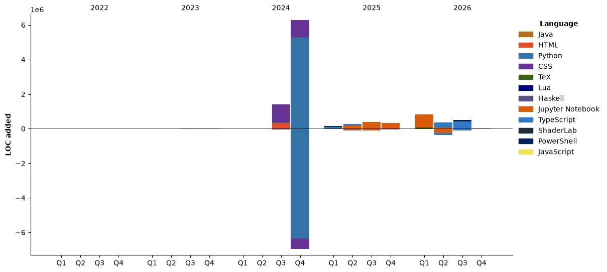

<h1 align="center">
  
</h1>

<p align="center">
  <a href="https://github.com/JSR-Mario"></a>
  <a href="https://www.linkedin.com/in/juan-sosa-997405294"></a>
  
</p>

---

```python
#!/usr/bin/python
# -*- coding: utf-8 -*-


class TechUser:

    def __init__(self):
        self.name = "Juan Mario Sosa"
        self.role = ["SRE","Software Engineer","Data scientist"]
        self.language_spoken = ["es_ES", "en_US"]

    def hi(self):
        print("This works ...")
        # TODO : ...

mario = TechUser()
mario.hi()
```

## Tech Stack

### Infra, Cloud & Observability


### Backend & Data


### Languages & Frontend


---

##  My Coding Activity

<!-- wakatime-stats injected here -->
<!--START_SECTION:waka-->


**🐱 My GitHub Data** 

> 📦 879.2 kB Used in GitHub's Storage 
 > 
> 🏆 1,629 Contributions in the Year 2026
 > 
> 💼 Opted to Hire
 > 
> 📜 30 Public Repositories 
 > 
> 🔑 9 Private Repositories 
 > 
**I'm a Night 🦉** 

```text
🌞 Morning                663 commits         ⣿⣿⣿⣀⣀⣀⣀⣀⣀⣀⣀⣀⣀⣀⣀⣀⣀⣀⣀⣀⣀⣀⣀⣀⣀   12.30 % 
🌆 Daytime                1274 commits        ⣿⣿⣿⣿⣿⣿⣀⣀⣀⣀⣀⣀⣀⣀⣀⣀⣀⣀⣀⣀⣀⣀⣀⣀⣀   23.63 % 
🌃 Evening                2709 commits        ⣿⣿⣿⣿⣿⣿⣿⣿⣿⣿⣿⣿⣿⣀⣀⣀⣀⣀⣀⣀⣀⣀⣀⣀⣀   50.25 % 
🌙 Night                  745 commits         ⣿⣿⣿⣀⣀⣀⣀⣀⣀⣀⣀⣀⣀⣀⣀⣀⣀⣀⣀⣀⣀⣀⣀⣀⣀   13.82 % 
```
📅 **I'm Most Productive on Wednesday** 

```text
Monday                   676 commits         ⣿⣿⣿⣀⣀⣀⣀⣀⣀⣀⣀⣀⣀⣀⣀⣀⣀⣀⣀⣀⣀⣀⣀⣀⣀   12.54 % 
Tuesday                  855 commits         ⣿⣿⣿⣿⣀⣀⣀⣀⣀⣀⣀⣀⣀⣀⣀⣀⣀⣀⣀⣀⣀⣀⣀⣀⣀   15.86 % 
Wednesday                966 commits         ⣿⣿⣿⣿⣀⣀⣀⣀⣀⣀⣀⣀⣀⣀⣀⣀⣀⣀⣀⣀⣀⣀⣀⣀⣀   17.92 % 
Thursday                 847 commits         ⣿⣿⣿⣿⣀⣀⣀⣀⣀⣀⣀⣀⣀⣀⣀⣀⣀⣀⣀⣀⣀⣀⣀⣀⣀   15.71 % 
Friday                   819 commits         ⣿⣿⣿⣿⣀⣀⣀⣀⣀⣀⣀⣀⣀⣀⣀⣀⣀⣀⣀⣀⣀⣀⣀⣀⣀   15.19 % 
Saturday                 569 commits         ⣿⣿⣿⣀⣀⣀⣀⣀⣀⣀⣀⣀⣀⣀⣀⣀⣀⣀⣀⣀⣀⣀⣀⣀⣀   10.55 % 
Sunday                   659 commits         ⣿⣿⣿⣀⣀⣀⣀⣀⣀⣀⣀⣀⣀⣀⣀⣀⣀⣀⣀⣀⣀⣀⣀⣀⣀   12.22 % 
```


📊 **This Week I Spent My Time On** 

```text
🕑︎ Time Zone: America/Mexico_City

💬 Programming Languages: 
Markdown                 4 hrs 23 mins       ⣿⣿⣿⣿⣿⣿⣿⣿⣿⣿⣿⣿⣿⣿⣿⣿⣿⣿⣿⣿⣿⣀⣀⣀⣀   83.84 % 
Other                    47 mins             ⣿⣿⣿⣿⣀⣀⣀⣀⣀⣀⣀⣀⣀⣀⣀⣀⣀⣀⣀⣀⣀⣀⣀⣀⣀   15.18 % 
Text                     3 mins              ⣀⣀⣀⣀⣀⣀⣀⣀⣀⣀⣀⣀⣀⣀⣀⣀⣀⣀⣀⣀⣀⣀⣀⣀⣀   00.97 % 

🔥 Editors: 
Obsidian                 4 hrs 23 mins       ⣿⣿⣿⣿⣿⣿⣿⣿⣿⣿⣿⣿⣿⣿⣿⣿⣿⣿⣿⣿⣿⣀⣀⣀⣀   83.84 % 
Antigravity              44 mins             ⣿⣿⣿⣿⣀⣀⣀⣀⣀⣀⣀⣀⣀⣀⣀⣀⣀⣀⣀⣀⣀⣀⣀⣀⣀   14.19 % 
Antigravity CLI          3 mins              ⣀⣀⣀⣀⣀⣀⣀⣀⣀⣀⣀⣀⣀⣀⣀⣀⣀⣀⣀⣀⣀⣀⣀⣀⣀   00.99 % 
VS Code                  3 mins              ⣀⣀⣀⣀⣀⣀⣀⣀⣀⣀⣀⣀⣀⣀⣀⣀⣀⣀⣀⣀⣀⣀⣀⣀⣀   00.97 % 

🐱‍💻 Projects: 
Obsidian Vault           4 hrs 23 mins       ⣿⣿⣿⣿⣿⣿⣿⣿⣿⣿⣿⣿⣿⣿⣿⣿⣿⣿⣿⣿⣿⣀⣀⣀⣀   83.84 % 
Unknown Project          44 mins             ⣿⣿⣿⣿⣀⣀⣀⣀⣀⣀⣀⣀⣀⣀⣀⣀⣀⣀⣀⣀⣀⣀⣀⣀⣀   14.19 % 
JSR-Mario                3 mins              ⣀⣀⣀⣀⣀⣀⣀⣀⣀⣀⣀⣀⣀⣀⣀⣀⣀⣀⣀⣀⣀⣀⣀⣀⣀   00.99 % 
DWB                      3 mins              ⣀⣀⣀⣀⣀⣀⣀⣀⣀⣀⣀⣀⣀⣀⣀⣀⣀⣀⣀⣀⣀⣀⣀⣀⣀   00.97 % 

💻 Operating System: 
Windows                  4 hrs 26 mins       ⣿⣿⣿⣿⣿⣿⣿⣿⣿⣿⣿⣿⣿⣿⣿⣿⣿⣿⣿⣿⣿⣀⣀⣀⣀   84.82 % 
Linux                    47 mins             ⣿⣿⣿⣿⣀⣀⣀⣀⣀⣀⣀⣀⣀⣀⣀⣀⣀⣀⣀⣀⣀⣀⣀⣀⣀   15.18 % 
```

🤖 **AI Coding This Week** 

```text
⏱ AI Coding Time: 47 mins (15.18%)

✍️ 0 lines written by AI, 247 lines written by hand (0.0% AI-written)

🔤 0 Input Tokens, 0 Output Tokens

💵 $0.00 Estimated AI Cost This Week

🧠 2 AI Sessions, 19 AI Prompts

🔎 AI Coding Insights:
🧑‍💻 Mostly Hands-On — 0.0% of written lines came from AI
📄 Detailed Prompter — average 564 characters per prompt
🔁 Iterative Prompter — average 10 prompts per session
🔍 Hands-On Reviewer — 100.0% of changed lines were hand-edited
```

**I Mostly Code in Java** 

```text
Jupyter Notebook         9 repos             ⣿⣿⣿⣿⣀⣀⣀⣀⣀⣀⣀⣀⣀⣀⣀⣀⣀⣀⣀⣀⣀⣀⣀⣀⣀   16.98 % 
TeX                      8 repos             ⣿⣿⣿⣿⣀⣀⣀⣀⣀⣀⣀⣀⣀⣀⣀⣀⣀⣀⣀⣀⣀⣀⣀⣀⣀   15.09 % 
TypeScript               5 repos             ⣿⣿⣀⣀⣀⣀⣀⣀⣀⣀⣀⣀⣀⣀⣀⣀⣀⣀⣀⣀⣀⣀⣀⣀⣀   09.43 % 
Python                   4 repos             ⣿⣿⣀⣀⣀⣀⣀⣀⣀⣀⣀⣀⣀⣀⣀⣀⣀⣀⣀⣀⣀⣀⣀⣀⣀   07.55 % 
PowerShell               1 repo              ⣀⣀⣀⣀⣀⣀⣀⣀⣀⣀⣀⣀⣀⣀⣀⣀⣀⣀⣀⣀⣀⣀⣀⣀⣀   01.89 % 
```


**Timeline**




 Last Updated on 15/11/2026 03:51:24 UTC
<!--END_SECTION:waka-->

---

<h2  align="center"> Check Out My Repos ⬇️ </h2>

